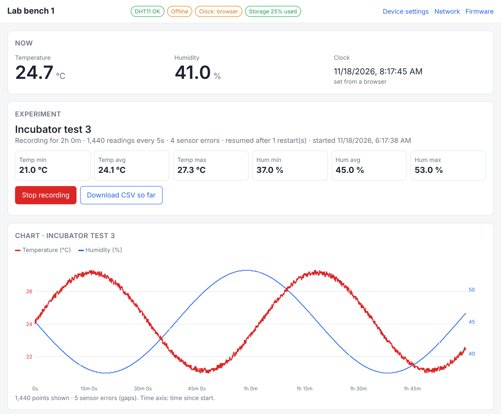
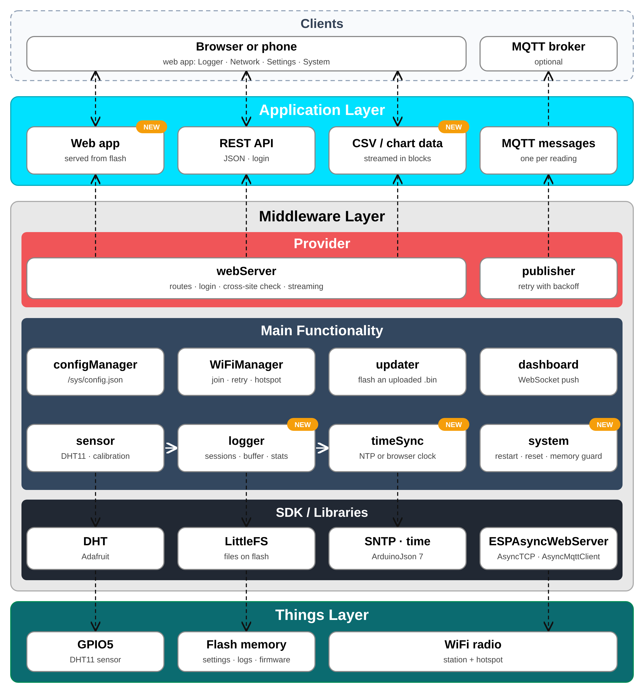

# WoT Temperature Logger Firmware for ESP8266

Firmware that turns an ESP8266 board and a DHT11 sensor into a temperature and humidity logger for experiments. Start a recording from your browser, watch a live chart, and download each recording as CSV. It works on its own WiFi hotspot, so you don't need internet access or a server.



*The logger page (sample data).*

## Features

- **Experiment sessions:** start and stop named recordings with notes. Each one is saved to the board's flash and survives restarts and power cuts.
- **Live chart:** temperature and humidity over time, with min, average and max for each session.
- **CSV export:** one click per session, with local time, unix time, elapsed seconds, temperature, humidity and a status column.
- **Real timestamps:** from internet time (NTP), or from your browser when there is no internet.
- **Calibration offsets** for temperature and humidity.
- **Configurable sample interval**, from 2 seconds to 1 hour.
- **WiFi setup portal:** the board opens its own hotspot when it can't join a network, and keeps retrying in the background.
- **Firmware update over WiFi** from the web interface.
- **Optional MQTT publishing** of every reading.
- **Login protection** for every page and API endpoint.

## Contents

- [Hardware](#hardware)
- [Build and flash](#build-and-flash)
- [First setup](#first-setup)
- [Recording an experiment](#recording-an-experiment)
- [Time and calibration](#time-and-calibration)
- [Device settings and maintenance](#device-settings-and-maintenance)
- [Security](#security)
- [MQTT (optional)](#mqtt-optional)
- [API reference](#api-reference)
- [Development](#development)
- [Troubleshooting](#troubleshooting)
- [Changelog](#changelog)

## Hardware

### Parts

| Part | Notes |
| --- | --- |
| ESP8266 board with 4 MB flash | Wemos D1 mini, Wemos D1, NodeMCU or similar |
| DHT11 sensor | DHT22 / DHT21 also supported (set the model in the settings file) |
| 10 kΩ resistor | Pull-up for the data line. Not needed on most 3-pin DHT11 modules, which have one built in |
| USB cable, jumper wires | |

### Wiring

| DHT11 pin | Connect to |
| --- | --- |
| VCC (pin 1) | 3V3 |
| DATA (pin 2) | GPIO 5, labeled **D1** on Wemos D1 mini and NodeMCU. Add the 10 kΩ resistor between DATA and 3V3 |
| NC (pin 3) | not connected |
| GND (pin 4) | GND |

Power the sensor from **3.3 V**, not 5 V. The pull-up then keeps the data line at a level the ESP8266 pins can safely handle. Keep the sensor wire under about 1 m for reliable readings.


> The older drawing above shows the sensor on the 5 V rail. Use 3V3 instead, as in the table.

## Build and flash

You need [PlatformIO](https://platformio.org/), either the VS Code extension or the command line.

1. Clone this repository.
2. Open the `firmware-back` folder (the one that contains `platformio.ini`).
3. Connect the board by USB.
4. Build and upload:

   ```
   cd firmware-back
   pio run -t upload
   pio device monitor
   ```

   In VS Code, use the PlatformIO **Upload** and **Monitor** buttons instead.

The serial monitor (115200 baud) shows the board's IP address, WiFi state and every reading. You don't need to upload a file system image. The board formats its flash storage on first start.

**Flash layout:** `eagle.flash.4m2m.ld`, which gives about 1 MB for the firmware, room for over-the-air updates, and 2 MB of storage for recordings.

## First setup

1. **Connect to the board.** If it has no WiFi network saved, it opens a hotspot named `WoT-XXXXXX` (unique per board) with password `12345678`. Join it and open `http://192.168.4.1`.
2. **Log in** with user `admin` and password `admin`.
3. **Change the admin password** right away. Run this from any computer on the same network:

   ```
   curl -u admin:admin -H "Content-Type: application/json" \
        -d '{"current":"admin","password":"your-new-password"}' \
        http://192.168.4.1/api/config/admin/set
   ```

4. **Join your WiFi** (optional) on the **Network** page. The board then gets an address from your router, which the serial monitor prints. If the network is down at power-on, or drops later, the board keeps retrying. After a while it opens the hotspot again so you can still reach it.
5. **Change the hotspot name and password** (optional) on the **Device settings** page. The hotspot password must be 8 to 63 characters.

## Recording an experiment

Open `http://<board address>/` to get to the logger page.

1. **Check the clock.** The header badge shows `Clock: ntp` when the board has internet. Otherwise opening the page sets the clock from your browser (`Clock: browser`).
2. **Start a session.** Enter a name, optional notes and the sample interval in seconds, then press **Start recording**.
3. **Watch it run.** The chart updates as readings arrive. Sensor errors show as gaps, and min, average and max update live. You can close the browser: recording continues on the board.
4. **Stop the session** with **Stop recording**.
5. **Download the data** with **CSV** in the sessions list, or **Download CSV so far** while it is still recording.
6. **Delete old sessions** to free space. Only stopped sessions can be deleted.

### What happens on a power cut

Readings are written to flash in batches, every 32 readings or every 2 minutes, which keeps flash wear low. A power cut loses at most the last batch. When the board starts again, it continues the same session automatically, and the session shows how many times it was resumed.

### Storage

The 2 MB storage holds about **160,000 readings**. The page shows the space left. Recording stops by itself when storage is almost full.

| Interval | Approximate capacity |
| --- | --- |
| 5 s | 9 days |
| 10 s | 18 days |
| 30 s | 55 days |
| 60 s | 110 days |

### CSV format

```
time_local,unix_time,elapsed_s,temperature_c,humidity_pct,status
2026-11-18T11:50:05+03:30,1794990005,0,24.7,41.0,ok
2026-11-18T11:50:15+03:30,1794990015,10,,,sensor_error
```

| Column | Meaning |
| --- | --- |
| `time_local` | Local time with UTC offset (ISO 8601). Empty if the clock was never set |
| `unix_time` | Seconds since 1970-01-01 UTC |
| `elapsed_s` | Seconds since the session started |
| `temperature_c`, `humidity_pct` | Calibrated readings with 0.1 resolution. Empty when the sensor failed |
| `status` | `ok` or `sensor_error` |

The file opens directly in Excel, LibreOffice, Python (pandas) or MATLAB.

## Time and calibration

Both are on the logger page under **Calibration and time**.

**Time**

- With internet, the board uses NTP (`pool.ntp.org` by default).
- Without internet, the clock and your UTC offset are set from the browser whenever you open the logger page. Open it once before starting a session. If the clock is set after a session started, earlier readings get their timestamps filled in from the start time.
- For automatic daylight saving time, enter a POSIX time zone such as `CET-1CEST,M3.5.0,M10.5.0/3` (Central Europe) or `EST5EDT,M3.2.0,M11.1.0` (US Eastern).
- The clock does not survive a power cut without NTP. Open the page again after one.

**Calibration**

Compare against a reference thermometer or hygrometer, and enter the difference as an offset. For example, if the sensor reads 0.8 °C high, enter `-0.8`. Offsets apply to new readings and are saved with each session. The DHT11 is accurate to about ±2 °C and ±5 %RH. For better accuracy use a DHT22 or an SHT31.

## Device settings and maintenance

The original settings pages are linked from the logger header.

| Page | Use it to |
| --- | --- |
| `/config` | Device name, hotspot name and password, sample interval, MQTT broker |
| `/network` | Join or forget a WiFi network, static IP |
| `/setting` | Upload and flash new firmware, restart, factory reset |

**Firmware update over WiFi:** build with `pio run`. On the **Firmware** page, upload `firmware-back/.pio/build/d1/firmware.bin`, flash it, then restart. A running session continues after the restart.

**Factory reset** restores the default settings, including the `admin` / `admin` login. Recorded sessions are kept.

Settings are stored as JSON in `/sys/config.json` on the board. The defaults live in `firmware-back/src/default/config.cpp`. Boards upgraded from v1.0 import their old settings automatically.

## Security

- Every page, API call and live update requires the admin login (HTTP Basic auth).
- Requests that change something are refused when they come from another website, so a malicious page in your browser cannot reset or reflash the board.
- Passwords are never sent back by the API. Leave a password field empty to keep the current one.
- Basic auth is not encrypted. Use the board on a trusted network, and change the default passwords.

## MQTT (optional)

Turn on MQTT on the **Device settings** page and enter the broker address (IP or hostname), port, topic and QoS. Every valid reading is published, with the retain flag set:

```
Topic: /temperature
{ "name": "WoT Device", "timestamp": 9801423, "value": { "temperature": 24.7, "humidity": 41.0 } }
```

`timestamp` is milliseconds since boot. Changes apply without a restart, and the board reconnects on its own if the broker goes away.

## API reference

All endpoints need HTTP Basic auth (user `admin`). JSON request bodies need `Content-Type: application/json`. Invalid input is rejected with HTTP 400 and a `message`.

### Logger

| Method | Endpoint | Body | Description |
| --- | --- | --- | --- |
| GET | `/api/logger/status` | | Current reading, clock, storage, running session |
| POST | `/api/session/start` | `{ "name": "Test 1", "notes": "", "rate": 10000 }` | Start a session (`rate` in ms, optional) |
| POST | `/api/session/stop` | | Stop the running session |
| GET | `/api/sessions` | | List sessions with stats |
| GET | `/api/session/data?id=N&from=0&step=1&max=2000` | | Readings as JSON rows `[elapsed_s, unix_time, temp, hum]` |
| GET | `/api/session/csv?id=N` | | Download a session as CSV |
| POST | `/api/session/delete?id=N` | | Delete a stopped session |
| GET | `/api/time` | | Clock status |
| POST | `/api/time/set` | `{ "epoch": 1794990005, "offset": 210 }` | Set the clock (`offset` = minutes east of UTC) |
| POST | `/api/config/time/set` | `{ "ntp": "pool.ntp.org", "tz": "UTC0" }` | NTP server and POSIX time zone |
| POST | `/api/config/calibration/set` | `{ "temp": -0.5, "hum": 2.0 }` | Calibration offsets (±10 °C, ±20 %RH) |

### Device

| Method | Endpoint | Body | Description |
| --- | --- | --- | --- |
| GET | `/api/index` | | Health check |
| GET | `/api/dashboard/get` | | Firmware, network, broker, uptime, free memory |
| GET | `/api/config/get` | | Settings (passwords omitted) |
| POST | `/api/config/device/set` | `{ "name": "WoT", "ssid": "WoT AP", "pass": "wot1234567" }` | Device name and hotspot |
| POST | `/api/config/device/setStatic` | adds `"ip"`, `"subnet"`, `"gateway"` | Hotspot with a custom address |
| POST | `/api/config/sensor/set` | `{ "rate": 5000 }` | Sample interval in ms (2000 to 3600000) |
| POST | `/api/config/broker/set` | `{ "status": true, "ip": "192.168.1.100", "port": 1883, "topic": "/temperature", "qos": 0 }` | MQTT broker |
| POST | `/api/config/admin/set` | `{ "current": "admin", "password": "new-password" }` | Change the admin password (8 to 64 characters) |
| GET | `/api/network/get` | | Hotspot status |
| POST | `/api/network/set` | `{ "ssid": "MyWiFi", "pass": "password" }` | Join a WiFi network |
| POST | `/api/network/setStaticIP` | adds `"ip"`, `"subnet"`, `"gateway"`, `"dns"` | Join with a static IP |
| POST | `/api/network/forget` | | Forget the WiFi network |
| POST | `/api/restart` | | Restart |
| POST | `/api/reset` | | Factory reset (keeps recordings) |
| GET | `/api/files/get` | | List uploaded files and storage use |
| POST | `/upload` | multipart file | Upload a file (letters, digits, `.`, `_`, `-`; max 31 characters) |
| GET | `/download/{filename}` | | Download an uploaded file |
| POST | `/api/files/remove?filename=...` | | Delete an uploaded file |
| POST | `/api/update?filename=...` | | Flash an uploaded firmware `.bin` |
| GET | `/api/update-status` | | Update status (254 busy, 1 done, 0 failed) |

A WebSocket at `/ws` pushes every new reading to the original dashboard.

## Development

### Project layout

```
firmware-back/
  platformio.ini         board, flash layout, pinned libraries
  src/
    main.cpp             starts the modules and runs the main loop
    sensor.cpp           DHT reading, retry, calibration
    logger.cpp           sessions, batched flash writes, resume, stats
    timeSync.cpp         NTP / browser time and time zone
    webServer.cpp        REST API, login, logger page, CSV streaming
    WiFiManager.cpp      WiFi connection, reconnect, setup hotspot
    configManager.cpp    settings in /sys/config.json, validation
    publisher.cpp        MQTT
    dashboard.cpp        WebSocket updates for the original dashboard
    updater.cpp          firmware update from an uploaded file
    system.cpp           restart and factory reset
    default/
      config.cpp         default settings
      html.h             original dashboard (built from firmware-front)
      logger_html.h      logger page (generated from web/logger.html)
  web/logger.html        logger page source
  tools/embed_html.py    gzips logger.html into logger_html.h
firmware-front/          Preact source of the original dashboard
doc/                     diagrams and screenshots
```

### Editing the logger page

Edit `firmware-back/web/logger.html` (plain HTML and JavaScript, no build step), then run:

```
python3 firmware-back/tools/embed_html.py
```

### Editing the original dashboard

The settings pages are a [Preact](https://preactjs.com/) app in `firmware-front`. Running `npm run build` there regenerates `firmware-back/src/default/html.h`. To develop the UI from another origin, build the firmware with `-DWOT_ENABLE_CORS` (see `platformio.ini`), and never ship that build.

### Libraries

[ESP32Async ESPAsyncWebServer and ESPAsyncTCP](https://github.com/ESP32Async), [ArduinoJson 7](https://arduinojson.org/), [Adafruit DHT](https://github.com/adafruit/DHT-sensor-library), [AsyncMqttClient](https://github.com/marvinroger/async-mqtt-client), and [LittleFS](https://github.com/littlefs-project/littlefs) from the ESP8266 Arduino core 3.1.2.

### Architecture



The firmware is organized in three layers. The application layer has the web page, REST API and MQTT. The middleware layer has logging, WiFi, settings, time and updates. The things layer is the DHT sensor and the flash memory.

## Troubleshooting

| Symptom | What to check |
| --- | --- |
| Temperature shows `--` / "DHT11 error" | Wiring, the pull-up resistor, 3.3 V power. The serial monitor prints each failed read |
| Can't find the board on my network | Use the serial monitor for its IP, or join the `WoT-XXXXXX` hotspot and open `192.168.4.1` |
| Browser keeps asking for a password | Use user `admin` and your admin password. A factory reset brings back `admin` / `admin` |
| CSV has no `time_local` | The clock was not set. Open the logger page (browser time), or give the board internet access |
| Recording stopped by itself | Storage was full. Download and delete old sessions |
| Firmware update says "not enough space" | Make sure the board was flashed with the 4m2m layout from `platformio.ini` |

## Changelog

**v1.2.0: experiment logger**

- Sessions with start and stop, logging to flash, and resume after a restart
- Logger page with live chart, statistics, session list and CSV export
- NTP and browser time, time zones, calibration offsets

**v1.1.0: fixes and hardening**

- Fixed 17 bugs: readings kept as whole numbers, factory reset not saving, memory leaks, unsafe input handling and more
- Login on every page, protection against cross-site requests, passwords no longer returned by the API
- WiFi retries in the background and the setup hotspot reopens on long outages
- Settings stored as validated JSON. ArduinoJson 7 and the maintained async web server

**v1.0:** first release. Web dashboard, MQTT, setup hotspot, firmware update.

## Credits

Developed by IDAS Lab. Originally based on the [ESP8266 IoT framework](https://github.com/maakbaas/esp8266-iot-framework).
